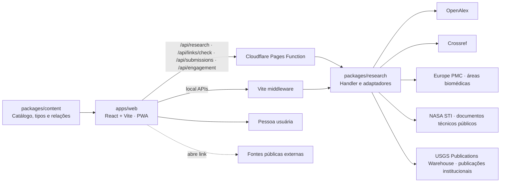

# Arquitetura atual da Sala de Calma e Estudo

## Resumo

O catálogo de artigos continua estático e compartilhado. O backend leve de descoberta de fontes públicas roda como Cloudflare Pages Functions. Em produção, D1 mantém sugestões para revisão, contadores de segurança e engajamento agregado; não é um CMS, não altera o catálogo e não publica artigos automaticamente. Não há conexão paga com modelo de IA.

## Onde cada coisa mora

- `packages/content/src/index.ts`: agrega os artigos editoriais dos módulos de conteúdo, 70 ciências/áreas e a opção “Todas”, trilhas de estudo, relações de próximo assunto e tutoriais. A contagem atual deve ser lida de `topics.length` para acompanhar novos artigos. As áreas são uma taxonomia; uma área pode ainda ter zero artigos.
- `packages/content/src/topics/`: módulos do catálogo editorial agrupados por áreas científicas; contratos e dados auxiliares ficam em módulos separados.
- `apps/web/src/App.tsx`: compõe as áreas da experiência e mantém estado da navegação. Diálogos, aparência, ilustrações, referências e sugestões ficam em `apps/web/src/features/`.
- `apps/web/src/shared/hooks/useStoredState.ts`: persistência local para preferências, assuntos salvos, progresso e sugestões sem acoplar cada feature diretamente ao armazenamento.
- `apps/web/src/features/engagement/useEngagement.ts`: cria/recupera um UUID local, carrega totais agregados e envia leituras e alterações de curtida.
- `apps/web/src/features/engagement/EngagementDashboard.tsx`: monta os rankings no cliente, só com conteúdos que têm atividade, e aplica critérios estáveis de desempate.
- `apps/web/src/features/map/KnowledgeMap.tsx`: monta um mapa navegável a partir dos vínculos em `relatedTopics`, `suggestedNextTopicIds` e das sequências das trilhas; não cria relações novas.
- `apps/web/src/PublicResearch.tsx`: explorador de registros acadêmicos públicos, seleção local e exportação de candidatos em JSON.
- `functions/api/research.ts`: backend de produção no Pages para `GET /api/research?q=...&field=...` (o diretório `functions` fica na raiz do projeto Pages).
- `functions/api/links/check.ts`: conferência pontual das referências do catálogo em uma lista permitida de domínios HTTPS.
- `functions/api/submissions.ts`: recebimento validado de sugestões e pacote de fontes em fila privada no D1; sem publicação automática.
- `functions/api/engagement.ts`: API de leituras e curtidas agregadas; valida tipo e ID contra o catálogo antes de escrever no D1.
- `functions/migrations/0002_content_engagement.sql`: tabelas e índices únicos para leitura e curtida por conteúdo e navegador anonimizado.
- `functions/_middleware.ts`: limites distribuídos de chamadas por rota e hash HMAC do endereço de rede antes de executar as Pages Functions.
- `apps/web/vite.config.ts`: middleware local que chama o mesmo handler durante `pnpm dev`.
- `packages/research/src/index.ts`: adaptadores, normalização, limites de busca, deduplicação e tratamento de indisponibilidade.
- `packages/content/src/expanded.ts`: seções explicativas adicionais para parte dos artigos do catálogo.
- `apps/web/src/`: estilos responsivos, paletas, layouts, ilustrações vetoriais locais e seletor de ciências.
- `docs/ORGANIZACAO_DO_MONOREPO.md`: limites entre apps, features, pacotes e backend, com convenções para ampliar o projeto.

`pnpm typecheck` e `pnpm build` são coordenados pelo Turbo. A checagem de tipos cobre web, pacotes e Pages Functions. A CI verifica também Prettier, testes, dependências e regras Semgrep.

## De onde vêm os dados

Os artigos do feed são registros editoriais escritos no pacote compartilhado. Além deles, a tela “Pesquisar fontes” pesquisa ao vivo em OpenAlex, OpenAIRE Graph e Crossref para localizar publicações de várias áreas; Europe PMC em áreas biomédicas; NASA STI em áreas relacionadas a espaço/engenharia e ciências físicas; e o Publications Warehouse do USGS em geociências e áreas relacionadas. OpenAIRE é um índice agregador, não uma fonte independente: seu resultado só ajuda a descobrir candidatos e não aumenta a contagem de confirmações. O DOI é conferido no Crossref; licença e texto integral são verificados separadamente pelo backend. Índices, catálogos e registros institucionais ajudam a localizar documentos; não atestam que um resultado esteja correto, revisado por pares ou independente de outro resultado.

OpenAlex aceita consultas básicas sem chave, mas recomenda a chave gratuita para uso contínuo e oferece uma cota diária maior. Ela pode ser configurada como segredo do Cloudflare, nunca no frontend ([documentação de acesso](https://help.openalex.org/api/authentication/)). Crossref permite consulta pública de metadados DOI sem cadastro; os metadados vêm de membros e fontes parceiras ([REST API](https://www.crossref.org/documentation/retrieve-metadata/rest-api/)). Europe PMC publica uma API REST com publicações e subconjunto open access; foi condicionado a busca biomédica e o leitor ainda deve conferir a licença do texto ([API e conteúdo](https://dev.europepmc.org/RestfulWebService)).

OpenAIRE Graph oferece uma API de consulta gratuita sobre publicações agregadas, com filtros para publicações revisadas por pares, DOI, licença e melhor acesso aberto ([início rápido](https://graph.openaire.eu/docs/apis/graph-api-v4/quickstart/), [sintaxe dos filtros](https://graph.openaire.eu/docs/apis/graph-api-v4/research-products/filter-syntax/)). O adaptador usa esses campos somente para descoberta, exige DOI confirmado no Crossref e revalida licença e texto integral pelo Europe PMC. Como OpenAIRE agrega metadados de vários provedores e pode repetir registros encontrados em outros catálogos, não é contabilizado como confirmação independente. A reutilização dos metadados segue os [termos oficiais de atribuição CC BY](https://graph.openaire.eu/docs/apis/terms/). A integração também exige identificador PMCID para obter o XML pelo endpoint conhecido da Europe PMC; por isso, a cobertura atual é mais útil em publicações biomédicas e não cresce igualmente em todas as áreas.

NASA STI permite pesquisar publicações científicas e técnicas da agência por API ([documentação para desenvolvedores](https://sti.nasa.gov/for-developers/), [guia da API](https://www.sti.nasa.gov/docs/20221122_OpenAPI_Documentation.pdf)). O adaptador exige distribuição pública, registro de documento integral, direito/licença pública identificável, ausência de material de terceiros sem permissão e PDF do domínio oficial acessível. O resultado é rotulado como publicação técnica institucional, não necessariamente revisada por pares.

O USGS Publications Warehouse oferece busca e serviços web de publicações ([documentação oficial](https://pubs.usgs.gov/documentation/web_service_documentation)). O adaptador exige autoria institucional do USGS e PDF servido pelo domínio oficial, além da checagem técnica do arquivo. A política de domínio público dos EUA para conteúdo produzido pelo governo tem ressalvas para materiais de terceiros ([FAQ de copyright do USGS](https://www.usgs.gov/faqs/are-usgs-reportspublications-copyrighted?qt-news_science_products=0)); por isso, a interface pede que o leitor confira os avisos do próprio documento.

O endpoint de pesquisa busca metadados em tempo real, mas só entrega resultados que passam pelo filtro estrito descrito abaixo. Resultados selecionados ficam no `localStorage` do navegador e podem ser exportados como `calmandstudy-fontes-para-revisao.json`; exigem revisão humana antes de serem usados como evidência editorial. O catálogo principal não é alterado por essa pesquisa.

O OpenAlex é consultado com a chave opcional do backend. Se a chave for recusada com erro de autorização, o adaptador repete uma única vez sem chave, usando a faixa pública gratuita. Na checagem cruzada, o adaptador primeiro compara os DOIs com os registros da busca geral do Crossref; para os DOIs do OpenAlex que não estiverem entre esses primeiros resultados, consulta o registro DOI exato no Crossref. Esse segundo passo evita falsos vazios por diferenças de ordenação entre catálogos sem relaxar as exigências de DOI, licença e texto integral aberto.

O filtro obrigatório descarta artigos retratados, preprints, versões sem licença Creative Commons identificada, registros sem DOI presente no Crossref e textos completos que não possam ser abertos naquele momento. Para OpenAlex, exige versão publicada ou aceita, periódico e URL PDF cujo tipo HTTP e assinatura `%PDF-` sejam conferidos. Para Europe PMC, exige artigo de periódico, PMCID, licença, DOI coincidente e XML integral acessível. NASA e USGS têm critérios institucionais e de direito próprios, descritos acima; não são apresentados como artigos de periódico, nem recebem cruzamento bibliográfico por Crossref. Para todos, o backend confirma resposta e assinatura do arquivo integral; resultados que falham ficam de fora.

Esse processo confirma que duas bases concordam na ficha bibliográfica, que há uma licença aberta declarada e que o texto integral respondeu ao teste técnico. Ele não confirma a verdade das conclusões, a independência intelectual das bases nem a qualidade do método científico. A interface apresenta esses sinais separadamente e recomenda comparar estudos independentes, dados e revisões antes de publicar afirmações.

Os cards e a página de leitura usam imagens e ilustrações incluídas localmente no projeto, com fallback vetorial quando necessário. Não fazem chamadas externas para carregar imagens. As ilustrações são decorativas e não constituem evidência histórica ou científica.

`GET /api/links/check?url=...` aceita até 24 referências HTTPS por consulta, restringe os domínios a fontes autorizadas, segue redirecionamentos seguros e usa cache por 30 minutos. A interface só exibe referências cuja resposta final seja HTTP 2xx na consulta. 404/410, 522, bloqueios, timeouts, falha da API e qualquer estado inconclusivo ocultam a seção inteira quando nenhuma outra referência passa. A checagem é pontual: uma resposta acessível hoje não garante disponibilidade futura.

## Busca, estado e personalização

- O feed inicial filtra por “Todas” e lista todos os artigos cadastrados. Busca e filtros rodam localmente sobre os dados já empacotados.
- As respostas JSON da API recebem cabeçalhos de segurança no próprio handler; `_headers` protege assets estáticos do Pages, mas não substitui cabeçalhos em Pages Functions.
- Pesquisa, checagem de links e envios têm limites distribuídos em D1. O handler de pesquisa mantém ainda limites auxiliares em memória por instância.
- O botão aleatório sorteia entre os artigos que correspondem ao filtro e à busca atuais.
- O menu **Jornada** monta três percursos de fases a partir de todos os artigos, trilhas e tutoriais. Cada fase reutiliza os builders de prova do pacote `@calmandstudy/content`; nota mínima de 8/10 aprova e libera a próxima fase dentro do percurso. Progresso, melhores notas e pontos ficam localmente em `calmandstudy-game-progress-v1`; não passam pelo Pages Function nem por D1.
- O tour inicial percorre os recursos da aplicação, altera a seção ativa, rola até o alvo e o destaca com um cursor ilustrativo. O balão mede o próprio tamanho e procura uma posição livre ao redor do destaque; para alvos grandes, escolhe o canto que cobre a menor área possível. A locução usa a Web Speech API (`SpeechSynthesis`) do navegador, quando disponível, sem chamada externa.
- As trilhas e recomendações de leitura anterior/próximo tema usam relações cadastradas por ID; quando uma trilha define sequência, a tela também sugere o assunto anterior perto do início do artigo. Nenhuma ordem é imposta.
- O **Mapa de assuntos** visualiza os vínculos editoriais das trilhas e recomendações. A busca e o filtro limitam o catálogo; a seleção de um artigo separa bases anteriores, próximos passos e temas relacionados. As conexões são sugestões de navegação, não relações de causa e efeito.
- A API de engajamento usa um `visitorId` local para reconhecer o mesmo navegador. O servidor assina esse identificador com HMAC e armazena somente o hash. As chaves únicas do D1 permitem uma leitura e uma curtida por navegador e conteúdo. Não há autenticação nem garantia de uma pessoa por identificador.
- Compartilhar usa o menu nativo (`navigator.share`) ou copia um endereço `?artigo=<id>`. Na abertura, o frontend valida o ID contra o catálogo versionado e abre o leitor; não há resolução em serviço externo.
- A web grava preferências, artigos salvos, progresso de tutoriais e rascunhos ainda não enviados em `localStorage`. Sugestões enviadas ficam no D1. Favoritos, progresso e seleções no mobile permanecem na sessão e não sincronizam entre dispositivos.
- A barra de progresso de leitura é opcional e a preferência fica em `localStorage`.

## O que significa “confiabilidade” hoje

O catálogo atual contém 79 artigos legados, mas nenhum tem um `EditorialRecord` completo com evidências por afirmação e revisão humana registrada. Portanto, **nenhum dos 79 está certificado pelo critério editorial novo**. Os percentuais antigos não são confiabilidade calculada: a interface os trata como pendentes/ilustrativos e não apresenta a lista de fontes como evidência verificada. O número de links nunca é usado como substituto de independência.

Um conteúdo só pode receber o estado `published` se **cada afirmação principal** tiver pelo menos três fontes que a apoiem, pertencentes a grupos editoriais independentes; as fontes devem ter texto integral de acesso aberto conferido nos últimos 90 dias; o índice editorial deve ser pelo menos 80/100; e uma pessoa revisora deve estar registrada. Reproduções do mesmo comunicado ou estudo contam como uma cadeia de evidência. Sugestões enviadas pelos leitores são pauta para análise, nunca publicação automática.

O índice editorial usa a soma ponderada: `round(0,25 × cobertura + 0,25 × qualidade + 0,20 × independência + 0,15 × concordância + 0,05 × atualidade + 0,10 × transparência)`. Cada dimensão recebe 0–100 e deve ter justificativa. É uma avaliação editorial da documentação, **não uma probabilidade matemática de verdade**. Link HTTP 2xx confirma apenas que a página respondeu naquele momento; não demonstra que ela sustenta a afirmação, que o texto completo é aberto nem que a fonte seja independente.

## Próximos limites e expansão

O contrato editorial está em `packages/content/src/editorial.ts`; schema, fluxo e metodologia estão documentados em `docs/FLUXO_EDITORIAL.md`. A validação checa a estrutura e consistência matemática, mas não abre links nem confirma que trechos sustentam afirmações. Candidatos precisam de edição/revisão humana e inclusão explícita no catálogo.

No celular, a PWA usa os mesmos endpoints da versão web; não há cliente nativo separado.

## Hospedagem escolhida

A publicação inicial será no Cloudflare Pages, usando o domínio gratuito `*.pages.dev`. Não é necessário registrar um domínio no Registro.br. Os artigos continuam estáticos e versionados em `packages/content`; Pages Functions consultam catálogos públicos e recebem sugestões. O D1 mantém essas sugestões e limita o uso das rotas; não gera nem publica artigos. Consulte [Fluxo editorial](FLUXO_EDITORIAL.md) para fontes e metodologia e [Segurança](SEGURANCA.md) para configurar as proteções.
