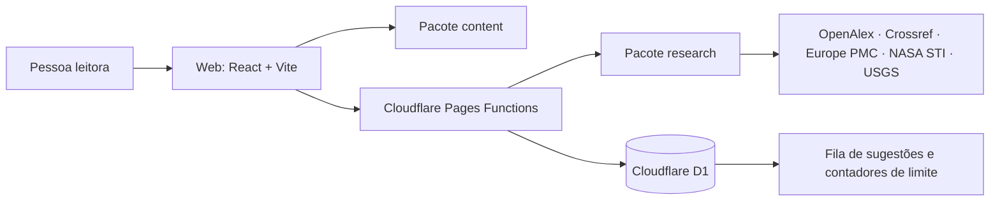

# Entendendo a Calm & Study

Este guia explica como a Calm & Study funciona hoje: onde ficam os artigos, como a pesquisa de fontes chega ao site, o que o D1 guarda, como executar e instalar a versão web responsiva e quais limites ainda existem.

## 1. A Calm & Study em poucas palavras

A Calm & Study é um app educativo de exploração. A pessoa pode descobrir um artigo ao acaso, filtrar por ciência, ler artigos, seguir trilhas, praticar em tutoriais e procurar referências públicas.

O sistema tem três partes principais:

1. **Aplicação:** site responsivo instalável como PWA.
2. **Conteúdo compartilhado:** artigos, áreas científicas, trilhas e tutoriais versionados junto ao código.
3. **Backend:** pesquisa de publicações em catálogos públicos, verificação de links e recebimento de sugestões.



Os artigos não são gerados ao vivo por uma IA e não são carregados do D1. O texto do catálogo é editado no repositório e só entra na aplicação quando uma alteração de conteúdo é publicada. As buscas externas ajudam a localizar documentos; seus resultados não viram artigos automaticamente.

## 2. Como o monorepo está organizado

| Pasta                 | Para que serve                                                                               |
| --------------------- | -------------------------------------------------------------------------------------------- |
| **apps/web**          | Site responsivo, telas, leitor, pesquisa, preferências e recursos de instalação PWA.         |
| **packages/content**  | Catálogo editorial e dados usados pela aplicação web.                                        |
| **packages/research** | Pesquisa em provedores públicos, normalização, filtros e verificação técnica dos documentos. |
| **functions**         | Rotas HTTP executadas pelo Cloudflare Pages.                                                 |
| **docs**              | Guias de operação, segurança, publicação e fluxo editorial.                                  |

### Conteúdo e organização de estudos

- **packages/content/src/topics/** contém artigos agrupados por assunto.
- **packages/content/src/fields.ts** contém a lista de ciências. Uma ciência pode existir no filtro e ainda não ter artigos.
- **packages/content/src/study-paths.ts** organiza artigos em sequências de aprendizagem.
- **packages/content/src/recommendations.ts** relaciona artigos anteriores ou próximos; as recomendações ajudam, mas não bloqueiam a leitura.
- **packages/content/src/tutorials.ts** contém roteiros práticos.
- **packages/content/src/assessments.ts** monta uma prova de múltipla escolha para cada artigo, trilha e tutorial, usando os dados editoriais compartilhados do catálogo.
- **packages/content/src/expanded.ts** guarda complementos para algumas leituras.
- **packages/content/src/editorial.ts** descreve o formato editorial preparado para registrar afirmações, evidências e revisões.

A quantidade de artigos deve vir de **topics.length**; evite fixar uma contagem manual no código ou na documentação.

### Provas de aprendizagem

- Cada artigo, trilha e tutorial oferece uma prova com cinco questões de múltipla escolha. Cada acerto vale dois pontos, para uma nota de zero a dez.
- As perguntas usam os próprios dados do conteúdo: artigo (ideia principal, resumo, desenvolvimento, área, período e palavras-chave), trilha (ideias dos artigos ligados à sequência) e tutorial (objetivo, etapas, materiais e conclusão).
- No site, a melhor nota fica no armazenamento local do navegador. No app mobile, a nota e as respostas ficam disponíveis enquanto o artigo está aberto; não há conta de usuário nem sincronização de resultados com o servidor.
- As questões são montadas a partir do catálogo, não geradas por IA em tempo real. O leitor pode conferir as respostas e explicações e refazer a prova.
- Na web, em larguras de tablet a navegação lateral vira um menu recolhível; as provas também passam a uma coluna antes que as alternativas fiquem apertadas. O realce dos cards usa uma amostra local da imagem como cor da sombra, com a cor da interface como reserva.

### Jornada gamificada

- O menu **Jornada** reúne todo o catálogo em três percursos: provas de artigos, provas de trilhas e provas de tutoriais. Cada conteúdo existente corresponde a uma fase; novos conteúdos entram no percurso automaticamente a partir do pacote `@calmandstudy/content`.
- As fases avançam em sequência dentro de cada percurso. A pessoa responde às cinco questões e precisa de **8/10** (quatro acertos) para liberar a fase seguinte; pode trocar de percurso sem perder o avanço dos demais.
- Cada fase aprovada rende pontos de jornada; uma nota perfeita dá bônus. Os marcos de progresso mudam o título de nível mostrado no painel. Uma tentativa abaixo de 8/10 exibe a resposta correta e a explicação antes de permitir nova tentativa.
- O progresso fica no `localStorage` da web na chave `calmandstudy-game-progress-v1`. Não exige conta, banco ou serviço de IA, e não sincroniza entre dispositivos. As questões reutilizam os mesmos geradores determinísticos das provas ao fim dos artigos, trilhas e tutoriais.

### Modos e lembretes de bem-estar

- **Estudo calmo** leva à descoberta e mantém uma apresentação discreta. **Modo aventura** abre a Jornada e organiza os mesmos artigos, trilhas e tutoriais como fases. O seletor do topo permite alternar; só a preferência de modo fica no `localStorage`, sem perfil nem conta.
- O check-in inicial é opcional. A resposta não é persistida nem enviada e não altera recomendações. Se a pessoa pedir recursos de apoio, são apresentados contatos oficiais; a Calm & Study não oferece diagnóstico ou atendimento.
- Após 30 minutos de aba visível, a interface pode sugerir uma pausa. A contagem existe apenas em memória durante a página, pausa quando a aba fica oculta e desaparece ao recarregar ou sair. Não coletamos horário local nem enviamos tempo de uso.
- Detalhes de experiência, limites e referências de ajuda estão em [Experiências de estudo](EXPERIENCIAS_DE_ESTUDO.md).

### Tour guiado com narração

- O tour de entrada acompanha as principais áreas e recursos: descoberta, artigo e prova, trilhas, tutorial e prova, pesquisa pública, salvos, estatísticas, novidades, agradecimentos, transparência, preferências, instalação PWA e envio de sugestão.
- Em cada passo, a página rola até o recurso, destaca o elemento e posiciona um cursor ilustrativo. A pessoa pode avançar, voltar, pausar a visita ou sair.
- O balão mede seu tamanho real e procura uma área livre ao redor do destaque; se o recurso ocupa muito espaço, usa o canto que encobre menos o alvo.
- Quando disponível, a narração usa **SpeechSynthesis** e as vozes em português instaladas no navegador. Não gera arquivo de áudio nem chama uma API externa. A pessoa pode silenciar; em navegadores sem suporte, o passeio continua apenas com texto. A preferência do sistema por movimento reduzido inicia o passeio pausado.

## 3. De onde vêm as informações

Há duas coisas diferentes no produto:

### Artigos da Calm & Study

São dados editoriais mantidos no próprio repositório em **packages/content**. As referências aparecem junto aos artigos. O catálogo não é uma cópia automática das buscas.

Os percentuais e rótulos demonstrativos que ainda aparecem em artigos não são uma auditoria independente nem a probabilidade de o texto estar correto. A presença de várias referências também não prova que elas sejam independentes ou que sustentem todas as frases. A Calm & Study informa essas limitações ao leitor.

### Pesquisa de fontes públicas

A tela **Pesquisar fontes** consulta os catálogos abaixo por meio de **packages/research**:

| Fonte                       | Uso nesta aplicação                                                        |
| --------------------------- | -------------------------------------------------------------------------- |
| OpenAlex                    | Descoberta multidisciplinar de trabalhos e versões de acesso aberto.       |
| Crossref                    | Conferência de metadados e DOI.                                            |
| Europe PMC                  | Publicações biomédicas, quando a área pesquisada é pertinente.             |
| NASA STI                    | Publicações técnicas e científicas relacionadas a espaço e áreas próximas. |
| USGS Publications Warehouse | Publicações institucionais de geociências, ambiente e áreas relacionadas.  |

Os provedores podem estar indisponíveis ou não se aplicar a uma área. A pesquisa sinaliza esses estados. O backend limita resultados, cruza os dados bibliográficos quando aplicável e exige sinais de acesso e procedência definidos no código. Para artigos acadêmicos, uma checagem automática não prova que o método seja bom, que o conteúdo esteja livre de qualquer restrição ou que a conclusão seja verdadeira. O leitor deve abrir e avaliar o documento original.

No OpenAlex, uma chave gratuita aumenta a cota, mas não é indispensável para tentar uma busca. Se uma chave opcional for recusada por autorização, o backend tenta uma vez a consulta pública sem ela. Para confirmar um DOI do OpenAlex, a Calm & Study também pode consultar esse DOI diretamente no Crossref; isso evita depender somente dos primeiros registros devolvidos pela busca bibliográfica geral. A verificação de DOI continua necessária e não substitui a checagem de licença e do arquivo integral.

Imagens e ilustrações são decorativas. Elas não são evidência para as afirmações do artigo.

## 4. O backend e suas rotas

Em produção, o diretório **functions/** na raiz do repositório é detectado pelo Cloudflare Pages. A lógica de pesquisa fica no pacote compartilhado para evitar manter uma implementação diferente no Vite e no Cloudflare.

| Rota                                  | O que faz                                                                                  |
| ------------------------------------- | ------------------------------------------------------------------------------------------ |
| **GET /api/research?q=...&field=...** | Pesquisa fontes públicas e devolve resultados que passaram pelas verificações automáticas. |
| **GET /api/links/check?url=...**      | Verifica referências do catálogo dentro de uma lista permitida de domínios.                |
| **POST /api/submissions**             | Recebe sugestões de temas, revisões de artigos e pacotes de referências para triagem.      |
| **GET /api/engagement?visitor=...**   | Devolve totais de leituras/curtidas e informa as curtidas deste navegador.                 |
| **POST /api/engagement**              | Registra leitura ou adiciona/remove curtida em artigo, trilha ou tutorial.                 |

Na máquina local, o Vite encaminha a pesquisa e a verificação de links para o handler em **packages/research**. O recebimento de sugestões é uma Cloudflare Pages Function; o servidor Vite sozinho não simula o D1 de produção.

### O que a pesquisa não faz

- Não usa uma API paga de geração de texto.
- Não publica um artigo a partir de uma busca.
- Não verifica automaticamente se cada afirmação do artigo é verdadeira.
- Não substitui a leitura da fonte, a curadoria e a revisão humana.

## 5. O que é salvo e onde

| Informação                                                                    | Local atual                                                                                                        |
| ----------------------------------------------------------------------------- | ------------------------------------------------------------------------------------------------------------------ |
| Artigos, áreas, trilhas e tutoriais                                           | Arquivos versionados em **packages/content**.                                                                      |
| Paleta, layout, fonte e tamanho de texto na web                               | **localStorage** do navegador.                                                                                     |
| Artigos salvos, progresso dos tutoriais e sugestões ainda não enviadas na web | **localStorage** daquele navegador e dispositivo.                                                                  |
| Artigos marcados manualmente como lidos                                       | **localStorage** na chave `calmandstudy-read-topics-v1`; é um estado pessoal deste navegador, sem sincronização.   |
| Pontos e fases aprovadas da Jornada gamificada                                | **localStorage** na chave `calmandstudy-game-progress-v1`; é um estado pessoal deste navegador, sem sincronização. |
| Resultados e referências escolhidas na pesquisa web                           | **localStorage**; podem ser enviados para revisão ou baixados como JSON.                                           |
| Sugestões e referências enviadas com sucesso                                  | Tabela **submissions** no Cloudflare D1, com estado inicial **pending**.                                           |
| Leituras e curtidas                                                           | Tabelas **content_reads** e **content_likes** no D1; uma participação por navegador/conteúdo.                      |
| Limites diários e limites por minuto                                          | Tabelas de contagem do D1; identificadores de acesso são guardados como HMAC, não como endereço IP em texto.       |

O D1 não é o banco do catálogo editorial e não publica conteúdo. Nas estatísticas, ele guarda apenas um registro por navegador e conteúdo, sem uma sequência detalhada de cada leitura. Também não existe uma tela administrativa dentro da Calm & Study para consultar a fila: a triagem é feita por uma pessoa com acesso ao console D1 da Cloudflare.

### Leituras, curtidas e estatísticas

O navegador cria um identificador aleatório (UUID) e o guarda no `localStorage`. Quando a pessoa abre um artigo, inicia um tutorial ou abre uma trilha, a web pode registrar uma leitura. O backend transforma o UUID em HMAC usando `SUBMISSION_HASH_SECRET` antes de gravá-lo; o identificador original não é armazenado no D1. Uma chave única no banco impede que o mesmo navegador conte repetidamente a leitura ou a curtida do mesmo conteúdo. Limpar os dados do navegador cria outro identificador, então os totais são aproximados e não equivalem a pessoas únicas verificadas.

A ação **Marcar como lido** é diferente dessa métrica pública: é uma lista pessoal guardada localmente e não envia evento ao D1. Assim, a pessoa pode acompanhar artigos concluídos sem afetar as estatísticas da comunidade.

Curtidas podem ser desfeitas. Na web, a página Estatísticas ordena os itens com atividade, remove os conteúdos zerados e usa o outro indicador e o título como desempate estável. Ela mostra totais agregados, não perfis nem histórico individual. A migração `functions/migrations/0002_content_engagement.sql` cria as tabelas e índices necessários. Sem o binding `DB`, o secret ou a migração, curtidas e estatísticas ficam indisponíveis; o catálogo continua funcionando.

### Compartilhar um artigo

O botão usa a API `navigator.share` do navegador quando disponível (normalmente abre o menu nativo do celular). Em navegadores sem essa API, copia o link. O endereço inclui o ID do artigo em `?artigo=...`; ao abrir, a aplicação procura esse ID apenas no catálogo publicado e abre o leitor correspondente. Se o ID não existir, o app segue normalmente. Fechar o leitor remove o parâmetro sem recarregar a página. É um link direto, sem encurtador externo ou conta de usuário.

## 6. Como funciona o envio de sugestões

1. A pessoa escreve uma pauta ou seleciona referências e envia.
2. O navegador conserva uma cópia local até receber confirmação do servidor.
3. A Function valida formato, tamanho, campos e origem.
4. O endpoint verifica os limites e insere o registro no D1.
5. A sugestão fica pendente de revisão. Não é publicada automaticamente.
6. Caso o limite diário seja atingido ou o serviço esteja indisponível, a interface explica o problema e mantém o rascunho local para tentar novamente.

No estado atual, o limite diário é de cinco envios por acesso, em dia UTC. Os limites por minuto são 20 para pesquisa, 12 para conferência de links, 10 para envios e 60 para engajamento. Veja [Envio de sugestões](ENVIO-DE-SUGESTOES.md) para consultar e atualizar a fila.

## 7. Segurança e privacidade

As rotas restringem métodos, origens, tamanhos e campos. A pesquisa externa aceita somente domínios autorizados e controla redirecionamentos para reduzir risco de SSRF. Há limites de tempo, tamanho de resposta e número de documentos verificados.

Em produção, as Functions usam D1 para aplicar limites distribuídos. São necessários:

- Binding D1 com o nome **DB**.
- Secret **SUBMISSION_HASH_SECRET**, com pelo menos 32 caracteres.
- Secret **OPENALEX_API_KEY**, obtido gratuitamente no OpenAlex, recomendado para sustentar a cota diária da busca multidisciplinar em produção.
- Migração **functions/migrations/0001_submissions.sql** aplicada ao banco.
- Migração **functions/migrations/0002_content_engagement.sql** aplicada ao banco para habilitar leituras, curtidas e a aba Estatísticas.

Se essas proteções não estiverem configuradas, os endpoints de produção recusam operações protegidas. Nunca coloque o secret no frontend, ou no Git. Consulte [Segurança](SEGURANCA.md) antes de alterar ou criar rotas.

## 8. Executar no computador

Requisitos: Node.js 22.13 ou superior e pnpm 10.

```sh
pnpm install
pnpm dev
```

Abra http://localhost:4173.

Comandos comuns, executados na raiz:

| Comando               | Resultado                                                            |
| --------------------- | -------------------------------------------------------------------- |
| **pnpm dev**          | Inicia o site web e seus handlers locais de pesquisa.                |
| **pnpm typecheck**    | Confere os tipos nos workspaces.                                     |
| **pnpm run build**    | Gera o build de produção da web, coordenado pelo Turbo.              |
| **pnpm format**       | Formata arquivos TS, TSX, JS, JSX, CSS e JSON com as regras da raiz. |
| **pnpm format:check** | Confere se esses arquivos já estão formatados sem alterá-los.        |

Pesquisas públicas exigem internet. O catálogo do projeto é servido localmente.

O Prettier está configurado em **.prettierrc.json**. `pnpm format:check` confere código, CSS, workflows do GitHub Actions e arquivos Markdown do guia. A CI também roda TypeScript, testes, build e auditoria de dependências; os detalhes e a trava para produção estão em [CI e liberação para produção](GITHUB_DEPLOY_GATE.md). Formatação não altera artigos nem executa testes.

## 9. Publicar a versão web

O destino atual é Cloudflare Pages com o endereço gratuito ***.pages.dev**; domínio próprio não é necessário.

No Cloudflare Pages, conecte o repositório Git, mantenha a raiz do projeto como diretório raiz e configure:

| Campo                  | Valor                                                |
| ---------------------- | ---------------------------------------------------- |
| Build command          | **pnpm install --frozen-lockfile && pnpm run build** |
| Build output directory | **apps/web/dist**                                    |
| Diretório de Functions | **functions/** na raiz                               |

Depois de criar o D1, aplique **functions/migrations/0001_submissions.sql** e **functions/migrations/0002_content_engagement.sql**, configure o binding **DB** e o secret **SUBMISSION_HASH_SECRET**, e faça um novo deploy. Mais detalhes e verificações pós-publicação estão em [Guia de execução e publicação](GUIA_EXECUCAO_PUBLICACAO.md).

O GitHub Actions faz os checks, mas não publica a aplicação. O Pages recebe o commit de `main` pela integração Git. Para barrar o deploy automático de mudanças sem aprovação dos checks, proteja `main` com o ruleset descrito em [CI e liberação para produção](GITHUB_DEPLOY_GATE.md). Sem essa regra no GitHub, os workflows só reportam o resultado depois do push.

## 10. Usar no celular

Abra a URL **.pages.dev** no navegador do telefone e escolha **Instalar a Calm & Study** ou **Adicionar à tela inicial**, conforme o navegador. A PWA é a única versão mobile mantida e usa a mesma aplicação web responsiva.

## 11. Termos que aparecem no projeto

- **Monorepo:** um repositório que contém mais de uma aplicação e pacotes compartilhados.
- **Workspace:** cada aplicação ou pacote que o pnpm instala e executa como parte desse repositório.
- **Pages Function:** código de backend executado pela Cloudflare junto ao site Pages.
- **D1:** banco SQLite gerenciado pela Cloudflare, usado para fila editorial, contadores de segurança, leituras e curtidas agregadas.
- **PWA:** site instalável como atalho com experiência semelhante a app; continua sendo a versão web.
- **Curadoria:** avaliação humana de texto, fontes, contexto, licença e limitações antes de incorporar conteúdo.
- **HMAC:** resumo criptográfico usado para contar limites sem gravar o endereço IP como texto.
- **UUID:** identificador aleatório criado no navegador. Aqui reconhece o mesmo navegador para evitar duplicar leituras/curtidas, mas não identifica uma pessoa real.
- **Deep link:** URL que aponta para uma tela ou conteúdo específico; aqui `?artigo=<id>` abre um artigo do catálogo.
- **API:** interface HTTP para o site conversar com o backend usando requisições e respostas, neste caso em JSON.
- **SSRF:** falha em que uma API é induzida a consultar endereços internos ou não autorizados; a pesquisa restringe domínios e redirecionamentos para reduzir esse risco.
- **Endpoint/rota:** endereço e método que identificam uma operação do backend. Por exemplo, `GET /api/engagement` lê agregados e `POST /api/engagement` solicita uma alteração.
- **D1 binding:** ligação configurada no Cloudflare entre o nome `DB` usado no código e uma instância do banco D1. Sem ela, a Function não sabe qual banco acessar.
- **Migração SQL:** arquivo numerado de instruções para criar ou alterar tabelas e índices de modo repetível. `0001` prepara sugestões e limites; `0002` prepara leituras e curtidas.
- **Rate limit:** limite de requisições por intervalo, usado para reduzir abuso e proteger as cotas dos provedores públicos.
- **CORS:** regra do navegador que define quais origens de site podem chamar uma API. Não substitui autenticação ou validação da própria rota.
- **CSP:** Content Security Policy, cabeçalho que restringe de onde a página pode carregar scripts, imagens, estilos e conexões.
- **localStorage:** espaço persistente do navegador neste dispositivo. Não sincroniza por si só com outros dispositivos nem com uma conta.
- **HSTS:** cabeçalho que orienta o navegador a acessar o site somente por HTTPS após a primeira resposta segura.

## 12. Documentos complementares

- [Arquitetura atual e fontes de dados](ARQUITETURA_ATUAL.md)
- [Organização do monorepo](ORGANIZACAO_DO_MONOREPO.md)
- [Fluxo editorial](FLUXO_EDITORIAL.md)
- [Envio e acompanhamento de sugestões](ENVIO-DE-SUGESTOES.md)
- [Política e configuração de segurança](SEGURANCA.md)
- [Acessibilidade](ACESSIBILIDADE.md)
- [Publicação web e uso da PWA](GUIA_EXECUCAO_PUBLICACAO.md)
- [Histórico de mudanças](../CHANGELOG.md)

## 13. Como manter este material útil

Quando uma mudança alterar uma função do app, uma rota, uma tabela, uma variável do Cloudflare, uma regra de segurança ou o modo de executar/publicar, atualize este guia e/ou [Arquitetura atual](ARQUITETURA_ATUAL.md) no mesmo commit do código. Explique o motivo, o caminho dos dados e o que a pessoa precisa configurar; não registre secrets nem valores pessoais. Para alterações que a pessoa usuária percebe, acrescente também um resumo curto ao [histórico de mudanças](../CHANGELOG.md). Assim o código e o material de estudo permanecem sincronizados a cada entrega.
