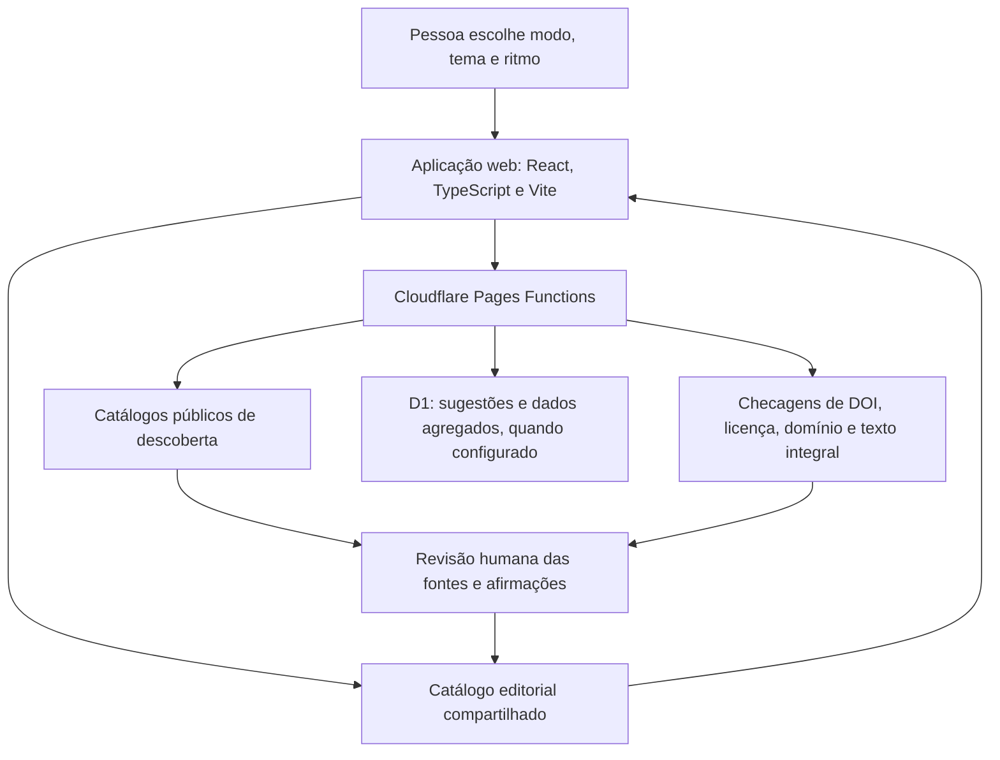

# Processo criativo e técnico

Este guia registra, em linguagem direta, como a Sala de Calma e Estudo tomou forma. Ele separa as ideias e decisões do criador do apoio prestado por IA e explica o caminho técnico sem tratar automação como autoridade.

## Quem fez o quê

- **Criador:** Ednaldo Nicolau dos Santos, brasileiro. Definiu o propósito, as prioridades, os limites editoriais, os modos de estudo e as decisões finais do produto.
- **Assistente de IA:** ajudou a explorar alternativas, transformar pedidos em propostas, implementar código, revisar problemas, organizar documentação e sugerir fontes. Suas sugestões só entraram no projeto depois de escolha e revisão do criador.
- **Comunidade:** pode propor melhorias e pautas. Contribuições passam pelas regras públicas e revisão humana; não são publicadas automaticamente.

O projeto tem origem brasileira, mas não limita o conhecimento ao Brasil. As pesquisas podem usar fontes públicas de diferentes países e instituições, se atenderem aos mesmos critérios de acesso, procedência, licença e revisão.

## Linha do tempo das decisões

Esta sequência mostra as etapas principais, não uma transcrição completa de cada conversa ou commit.

| Etapa                    | Ideia ou decisão                                                                                                                                        | Origem e responsabilidade                                                                            |
| ------------------------ | ------------------------------------------------------------------------------------------------------------------------------------------------------- | ---------------------------------------------------------------------------------------------------- |
| 1. Descobertas curtas    | Criar um lugar para aprender por artigos breves, com escolha de assunto ou exploração aleatória.                                                        | Ideia e direção do criador.                                                                          |
| 2. Identidade do projeto | A IA sugeriu o nome inicial. O criador o adotou por sua representação feminina e acolhedora, mantendo o espaço aberto a qualquer pessoa.                 | Sugestão de nome: IA. Decisão, intenção e adoção: criador.                                           |
| 3. Conteúdo com contexto | Incluir áreas variadas, relações entre assuntos, trilhas, tutoriais, imagens e exercícios para tornar a leitura mais clara e conectada.                 | Necessidades definidas pelo criador; propostas de organização e execução elaboradas em conjunto.     |
| 4. Fontes e rigor        | Priorizar fontes públicas, gratuitas, rastreáveis e com direitos claros; separar descoberta automática, confirmação documental e revisão humana.        | Critério definido pelo criador; adaptadores e filtros foram implementados com apoio de IA.           |
| 5. Dois ritmos           | Manter o mesmo catálogo e os mesmos critérios em um modo calmo e em um modo aventura com navegação própria.                                             | Decisão do criador; desenho da experiência e implementação apoiados por IA.                          |
| 6. Cuidado e autonomia   | Tornar acolhimento, acessibilidade, áudio, pausas e check-in opcionais, sem diagnosticar nem pressionar a pessoa.                                       | Objetivo definido pelo criador; implementação apoiada por IA.                                        |
| 7. Abertura do projeto   | Manter acesso gratuito, abrir o código e aceitar contribuições dentro das regras editoriais e de segurança.                                             | Decisão do criador após avaliar as opções com apoio de IA.                                           |
| 8. Nome em português     | Adotar “Sala de Calma e Estudo” como marca principal para falar primeiro com o público brasileiro, mantendo fontes e conteúdo de alcance internacional. | Decisão do criador; apoio de IA na transição da marca e dos textos.                                  |
| 9. Operação simples      | Usar uma aplicação web instalável, serviços gratuitos da Cloudflare, CI para verificações e Docker Compose para execução local.                         | Preferências e decisões do criador; alternativas técnicas avaliadas e implementadas com apoio de IA. |

## Processo criativo em duas frentes

### O que o criador definiu

O criador trouxe o propósito educativo, a linguagem acolhedora, a liberdade de navegação, a exigência de fontes verificáveis e as prioridades de segurança, acessibilidade e custo zero sempre que possível. Também definiu o público amplo, a possibilidade de escolher entre estudo calmo e aventura, o caráter opcional dos recursos de conforto e a revisão humana antes de publicar conteúdo novo.

### Onde a IA ajudou

A IA ajudou a comparar tecnologias, organizar requisitos, propor estruturas de navegação e conteúdo, redigir primeiras versões de documentação, implementar componentes e integrações, localizar defeitos e sugerir verificações. A IA também sugeriu o nome inicial; o criador decidiu adotá-lo e, depois, escolheu a marca em português.

Uma sugestão da IA não é uma decisão do criador. O fato de um código ter sido escrito com assistência de IA tampouco torna seu comportamento correto ou seguro: ele precisa passar por revisão, checagens automatizadas e avaliação humana.

## Mapa técnico resumido

As setas representam o fluxo previsto. Uma busca não altera o catálogo. D1 não publica artigos. A revisão humana é uma etapa editorial separada.

## Como uma fonte encontrada é tratada

1. Um ou mais catálogos públicos ajudam a localizar um documento candidato.
2. O backend confere metadados, identificadores, direitos e disponibilidade do texto conforme a rota da fonte.
3. Uma base agregadora, como OpenAIRE, serve para descoberta e não conta como confirmação independente.
4. A pessoa revisora precisa ler o material, ligar evidências às afirmações, avaliar independência e contexto e registrar as limitações.
5. Só uma alteração editorial explícita pode incluir o conteúdo no catálogo.

Os filtros automáticos ajudam a verificar procedência e acesso; não provam que cada afirmação seja verdadeira, nem substituem revisão por pares ou julgamento editorial. A biblioteca atual ainda contém conteúdos legados cuja documentação não satisfaz integralmente o padrão editorial planejado.

## Limites e atualização deste guia

Este registro foi reconstruído a partir das decisões disponíveis no histórico do projeto e dos documentos atuais. Ele não pretende atribuir com certeza cada detalhe de todos os commits. Quando uma decisão mudar, atualize esta página, o guia técnico correspondente e o changelog. Separe sempre: **pedido ou decisão do criador**, **sugestão de IA**, **implementação realizada** e **verificação feita**.

Para detalhes operacionais, consulte o [guia de arquitetura](ARQUITETURA_ATUAL.md), o [fluxo editorial](FLUXO_EDITORIAL.md), o [guia para executar localmente](RODAR_LOCALMENTE.md) e as [regras para contribuir](../CONTRIBUTING.md).
